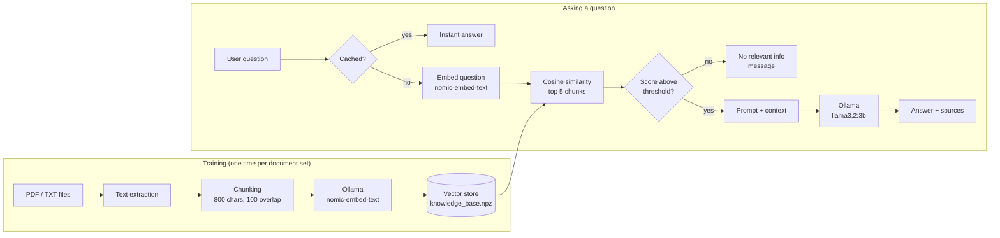

# 🩺 Medical AI Chatbot

### A fully offline, document-based medical Q&A assistant built with Flask, Ollama and RAG


Upload your own medical PDFs or text files, train a local knowledge base, and ask questions in plain English. Every answer is generated **only from your documents** and comes with the file names and page numbers it was based on.

**No API keys. No accounts. No cloud. Your documents never leave your computer.**

---

## 📑 Table of Contents

- [Overview](#-overview)
- [Features](#-features)
- [How It Works](#-how-it-works)
- [Tech Stack](#-tech-stack)
- [Project Structure](#-project-structure)
- [Getting Started](#-getting-started)
- [Configuration](#-configuration)
- [Usage](#-usage)
- [API Reference](#-api-reference)
- [Response Caching](#-response-caching)
- [Troubleshooting](#-troubleshooting)
- [Medical Disclaimer](#-medical-disclaimer)
- [Future Improvements](#-future-improvements)
- [Author](#-author)

---

## 🔍 Overview

General-purpose chatbots can answer medical questions, but they can also make things up, and they send your data to a remote server. This project takes a different approach using **Retrieval-Augmented Generation (RAG)**:

1. You provide trusted medical documents.
2. The app splits them into chunks and converts each chunk into a vector embedding.
3. When you ask a question, only the most relevant chunks are retrieved.
4. A local LLM writes an answer using **only** that retrieved context.

If your documents do not cover the question, the chatbot says so instead of guessing.

Everything (embeddings, search, and answer generation) runs on your own machine through [Ollama](https://ollama.com). The internet is needed only once, to install packages and download the models.

---

## ✨ Features

| Area | What you get |
| --- | --- |
| **Document management** | Upload multiple PDF/TXT files at once, delete files from the UI, non-English file names supported, duplicate names are renamed instead of overwritten |
| **Knowledge base training** | One-click training with a live progress bar (stage, chunks embedded, elapsed time, estimated time left). Progress survives a page refresh |
| **Safe rebuilds** | The old knowledge base is replaced only after a new one is built successfully, so a failed run never corrupts it |
| **Local semantic search** | 768-dimensional embeddings from `nomic-embed-text`, cosine similarity search with NumPy, saved to a single `.npz` file |
| **Relevance threshold** | Chunks scoring below a configurable similarity are ignored, so off-topic questions are not answered from unrelated text |
| **Grounded answers** | The `llama3.2:3b` model answers only from retrieved context, with source file and page numbers shown for each answer |
| **Response cache** | Repeated questions are answered instantly from a persistent cache that invalidates itself when the knowledge base or settings change |
| **Safety-minded prompt** | No definitive diagnoses, no medicine or dosage prescriptions, urgent-care advice for possible emergencies |
| **Scanned-PDF handling** | Pages without a text layer are skipped and reported after training |
| **Clean UI** | Separate dashboard and Q&A page, example questions, Enter to send, Shift+Enter for a new line |

---

## ⚙️ How It Works



**Training pipeline**

1. **Read** every PDF/TXT file in `backend/data/uploads/`
2. **Chunk** the text with a recursive character splitter (default 800 characters, 100 overlap)
3. **Embed** the chunks in batches using `nomic-embed-text`
4. **Save** normalised vectors plus metadata (source file, page, text) to `knowledge_base.npz`

**Question pipeline**

1. Normalise the question and check the response cache
2. Embed the question and run cosine similarity against the knowledge base
3. Keep the top-K chunks that pass the relevance threshold
4. Build a strict prompt from those chunks and send it to the local LLM
5. Return the answer together with its sources, then cache it

---

## 🧰 Tech Stack

| Layer | Technology |
| --- | --- |
| Backend | Python 3.12, Flask 3 |
| LLM and embeddings | Ollama with `llama3.2:3b` and `nomic-embed-text` |
| RAG tooling | LangChain (`langchain-core`, `langchain-text-splitters`, `langchain-ollama`) |
| Vector search | NumPy cosine similarity, stored as a `.npz` file |
| PDF parsing | pypdf |
| Frontend | HTML, CSS, vanilla JavaScript (served by Flask) |
| Config | python-dotenv |

---

## 📁 Project Structure

```text
chatboat/
├── backend/
│   ├── app.py                  # Flask app, routes, background training job
│   ├── config.py               # Settings loaded from .env
│   ├── requirements.txt
│   ├── .env.example            # Copy to .env to customise settings
│   ├── data/
│   │   ├── uploads/            # Your PDF/TXT documents (git-ignored)
│   │   ├── vector_store/       # knowledge_base.npz (git-ignored)
│   │   └── cache/              # responses.json (answer cache)
│   └── src/
│       ├── create_embeddings.py   # Read, chunk, embed, save
│       ├── vector_store.py        # Save/load/search the .npz store
│       ├── RAG.py                 # Retrieval step (the "R" in RAG)
│       ├── chatbot.py             # Prompt building and LLM generation
│       └── cache.py               # Question to answer cache
├── frontend/
│   ├── templates/
│   │   ├── index.html          # Dashboard: upload, train, status
│   │   └── qa.html             # Question and answer page
│   └── static/
│       ├── css/style.css
│       └── js/
│           ├── script.js
│           └── qa.js
├── .gitignore
└── README.md
```

---

## 🚀 Getting Started

### Prerequisites

- **Python 3.12** (recommended)
- **[Ollama](https://ollama.com/download)** installed and running
- About **4 to 6 GB of free disk space** for the models
- Internet access for the one-time setup only

### 1. Clone the repository

```bash
git clone https://github.com/<your-username>/<your-repo-name>.git
cd <your-repo-name>
```

### 2. Install Ollama and pull the models

```bash
ollama --version
ollama pull nomic-embed-text
ollama pull llama3.2:3b
ollama list
```

Keep Ollama running while you use the chatbot.

### 3. Create a virtual environment

**Windows (PowerShell)**

```powershell
py -3.12 -m venv venv
.\venv\Scripts\Activate.ps1
```

If PowerShell blocks the activation script:

```powershell
Set-ExecutionPolicy -Scope Process -ExecutionPolicy Bypass
.\venv\Scripts\Activate.ps1
```

**macOS / Linux**

```bash
python3 -m venv venv
source venv/bin/activate
```

### 4. Install dependencies

```bash
cd backend
python -m pip install --upgrade pip
pip install -r requirements.txt
```

### 5. (Optional) Configure settings

The defaults work out of the box. To customise, copy the example file:

```bash
# Windows
copy .env.example .env

# macOS / Linux
cp .env.example .env
```

### 6. Run the app

```bash
python app.py
```

Open **http://127.0.0.1:5000** in your browser.

---

## 🔧 Configuration

All settings live in `backend/.env`. Every value is optional.

| Variable | Default | Description |
| --- | --- | --- |
| `OLLAMA_BASE_URL` | `http://localhost:11434` | Where Ollama is running |
| `OLLAMA_LLM_MODEL` | `llama3.2:3b` | Model used to write answers |
| `OLLAMA_EMBEDDING_MODEL` | `nomic-embed-text` | Model used to create embeddings |
| `EMBEDDING_DIMENSION` | `768` | Vector size; must match the embedding model |
| `CHUNK_SIZE` | `800` | Characters per chunk |
| `CHUNK_OVERLAP` | `100` | Characters shared between neighbouring chunks |
| `TOP_K` | `5` | Maximum chunks retrieved per question |
| `RELEVANCE_THRESHOLD` | `0.45` | Minimum cosine similarity (0 to 1) for a chunk to be used |
| `CACHE_ENABLED` | `true` | Turn the response cache on or off |
| `CACHE_MAX_ENTRIES` | `500` | Maximum cached answers (least recently used are dropped) |
| `CACHE_TTL_HOURS` | `168` | Cache lifetime in hours (`0` means never expire) |
| `MAX_CONTENT_LENGTH_MB` | `50` | Maximum upload size |
| `FLASK_DEBUG` | `false` | Use `true` for local development only |

> 💡 **Tuning tip:** If relevant questions return "could not find relevant information", lower `RELEVANCE_THRESHOLD` (for example `0.35`). If unrelated questions still get answers, raise it (for example `0.55`). Restart the app after changing it.

---

## 📖 Usage

### 1. Upload documents

Click **Upload Documents** and select one or more `.pdf` or `.txt` files.

### 2. Train the knowledge base

Click **Train Knowledge Base**. A progress panel shows the four stages: reading documents, splitting into chunks, creating embeddings, and saving. Training is rebuilt from scratch from the current uploads every time, so after adding or deleting documents, train again.

> Scanned PDFs without a text layer cannot be read. Run OCR on them before uploading.

### 3. Ask questions

Click **Ask Medical AI** (or open `http://127.0.0.1:5000/qa`). Type a question or click an example:

- *What are the common symptoms of anemia?*
- *What causes high blood sugar?*
- *How is high blood pressure detected?*

Each answer lists the documents and pages it came from.

### Run the backend scripts on their own

From the `backend/` folder:

```bash
python src/create_embeddings.py                       # train from the command line
python src/chatbot.py                                 # chat in the terminal
python src/RAG.py "What are the symptoms of anemia?"  # inspect retrieval only
```

The retrieval script prints every top match with its similarity score and whether it was **USED** or **IGNORED**, which makes it easy to tune `RELEVANCE_THRESHOLD`.

---

## 🌐 API Reference

| Method | Endpoint | Description |
| --- | --- | --- |
| `GET` | `/` | Dashboard page |
| `GET` | `/qa` | Q&A page |
| `POST` | `/upload` | Upload one or more PDF/TXT files (`multipart/form-data`, field `files`) |
| `GET` | `/documents` | List uploaded documents |
| `DELETE` | `/documents/<name>` | Delete an uploaded document |
| `POST` | `/train` | Start training in a background thread |
| `GET` | `/train/status` | Live training progress (stage, percent, elapsed time) |
| `GET` | `/status` | Knowledge base summary (chunks, documents, model, created time) |
| `POST` | `/chat` | Ask a question |
| `GET` | `/cache` | Cache statistics |
| `POST` | `/cache/clear` | Clear all cached answers |

**Example: ask a question**

```bash
curl -X POST http://127.0.0.1:5000/chat \
  -H "Content-Type: application/json" \
  -d '{"message": "What are the common symptoms of anemia?"}'
```

```json
{
  "success": true,
  "response": "The common symptoms of anemia include fatigue and weakness, pale or yellowish skin, ...",
  "sources": [
    { "source": "Common_Medical_Conditions_Reference.pdf", "page": 4, "score": 0.8284 }
  ],
  "cached": false
}
```

---

## ⚡ Response Caching

Repeated questions skip retrieval and the LLM entirely and return instantly.

- Questions are normalised (case, spacing, trailing punctuation), so *"What is anemia?"* and *"what is anemia"* share one entry.
- Each cached answer is tied to a **fingerprint** of the knowledge base and settings: training time, chunk count, embedding model, LLM model, `TOP_K`, threshold and prompt version. Re-training or changing any of these makes old entries stop matching automatically.
- The cache is saved to `backend/data/cache/responses.json`, so it survives restarts.
- It is capped by `CACHE_MAX_ENTRIES` and entries expire after `CACHE_TTL_HOURS`.

---

## 🛠 Troubleshooting

<details>
<summary><b>Ollama connection error</b></summary>

Make sure Ollama is running and both models are installed:

```bash
ollama list
```

If a model is missing, run `ollama pull nomic-embed-text` or `ollama pull llama3.2:3b`.
</details>

<details>
<summary><b>"The knowledge base has not been trained yet"</b></summary>

No `knowledge_base.npz` exists yet. Upload documents, then click **Train Knowledge Base**.
</details>

<details>
<summary><b>Embedding dimension mismatch</b></summary>

`nomic-embed-text` returns 768 dimensions. If you switch to a different embedding model, set `EMBEDDING_DIMENSION` to that model's size in `.env`, then train again.
</details>

<details>
<summary><b>The app asks me to re-train after changing the embedding model</b></summary>

Vectors from different models cannot be compared. Click **Train Knowledge Base** to rebuild with the new model.
</details>

<details>
<summary><b>Answers say "could not find relevant information" too often (or answer off-topic questions)</b></summary>

Tune `RELEVANCE_THRESHOLD` in `.env`, then restart the app. Use `python src/RAG.py "your question"` to see the actual similarity scores.
</details>

<details>
<summary><b>The page looks broken or mixes old and new styles</b></summary>

Your browser has cached old frontend files. Restart `python app.py` and hard-refresh with **Ctrl + F5**.
</details>

<details>
<summary><b>Start completely fresh</b></summary>

Stop the app and delete `backend/data/vector_store/knowledge_base.npz` (and optionally `backend/data/cache/responses.json`).
</details>

---

## ⚠️ Medical Disclaimer

This project is an **educational, document-based information assistant. It is not a doctor** and must not be used for diagnosis, treatment decisions or emergencies. The prompt is designed to avoid definitive diagnoses and medication or dosage advice, but a small local model can still make mistakes. Answers are only as good as the documents you provide. Always consult a qualified healthcare professional, and seek urgent medical care for emergency symptoms.

---

## 🔮 Future Improvements

- OCR support for scanned PDFs
- Support for DOCX and other document formats
- Conversation memory for follow-up questions
- Streaming responses in the UI
- Multiple knowledge bases (for example per specialty)
- Docker setup for one-command deployment
- Automated tests for retrieval quality

---

## 👤 Author

**Gaurav Rajpoot**
B.Tech in Computer Science Engineering (AI/ML), IMS Engineering College, Ghaziabad

- GitHub: https://github.com/Gauravrajpoot9
- LinkedIn: www.linkedin.com/in/-518109295
---

## 📄 License

This project is licensed under the MIT License. See the [LICENSE](LICENSE) file for details.

> ⭐ If you found this project useful, consider giving it a star on GitHub.
